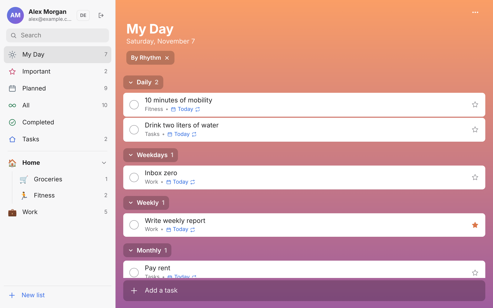
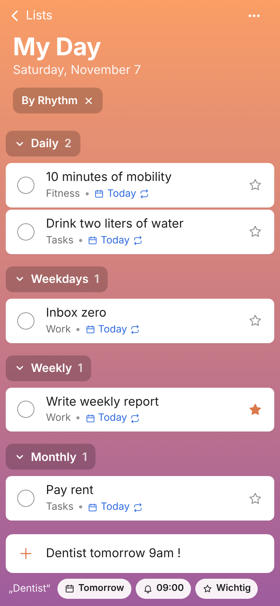

# Tagwerk

**Microsoft To Do, minus the uncertainty.** A native iPhone app and a web app with the same workflow, synced in real time through your own Supabase project.

[](LICENSE)


<p>
  
  
</p>

## Why Tagwerk?

Microsoft To Do still works, but it has been in maintenance mode for a while: no new features, and Microsoft is steering users toward Planner and Copilot instead. Tagwerk keeps the parts that made To Do good and puts the data in a database you own.

- **Same muscle memory.** My Day, smart lists, groups, steps, repeat rules, emoji list icons.
- **Your data.** One Postgres database, row-level security, no third-party account.
- **Real time.** Changes land on every device in a second or two.
- **Offline first on iPhone.** Local SwiftData store; the widget and badge never wait for the network.

## What's different from To Do

| | |
| --- | --- |
| **Quick add** | Type `Dentist tomorrow 9am !` or `Zahnarzt morgen 9 Uhr !` and get a starred task, due tomorrow, reminder at 09:00. Understands dates, weekdays, times and repeat rules in English and German. |
| **My Day by rhythm** | Grouped into daily, weekdays, weekly, monthly, yearly and one-time, so recurring habits sit on top. Or group by list. |
| **Widget** | Home and Lock Screen. Check tasks off without opening the app. |
| **App badge** | Open tasks in My Day, updated at midnight without launching the app. |
| **Web app** | Same views in any browser; installable on the iPhone home screen. |
| **Two languages** | English and German, switchable in settings. |

## Stack

- **iOS:** SwiftUI, SwiftData, WidgetKit, App Intents. No dependencies.
- **Web:** plain HTML, CSS and JavaScript with supabase-js. No build step.
- **Backend:** Supabase (Postgres, Auth, Realtime).

## Quick start

### 1. Supabase

Create a project, then run [`supabase/schema.sql`](supabase/schema.sql) in the SQL editor. After creating your own account, turn off *Allow new users to sign up* under Authentication.

### 2. Web

```sh
cd web
SUPABASE_URL=https://<project>.supabase.co SUPABASE_ANON_KEY=<anon key> sh build.sh   # writes config.js
npx serve .
```

On Vercel: import the repo, set Root Directory to `web`, add `SUPABASE_URL` and `SUPABASE_ANON_KEY` as environment variables. `vercel.json` runs `build.sh`. Add the deployed URL as *Site URL* in Supabase Auth.

### 3. iPhone

Create `Config.local.xcconfig` next to `Config.xcconfig` (it is git-ignored):

```
BUNDLE_ID_PREFIX = com.yourname
DEVELOPMENT_TEAM = ABCDE12345
TAGWERK_APP_GROUP = group.com.yourname.tagwerk
SUPABASE_HOST = <project>.supabase.co
SUPABASE_ANON_KEY = <anon key>
```

Open `Tagwerk.xcodeproj` and run. With a free Apple ID the install expires after 7 days; reinstalling keeps your data.

## Layout

```
Tagwerk/          iPhone app: views, quick add, sync
Shared/           shared with the widget: model, store, badge, change log, translations
TagwerkWidget/    My Day widget
web/              web app
supabase/         database schema
```

## How sync works

- Supabase is the source of truth. Tables `groups`, `lists`, `tasks`, `steps`; deletes are soft (`deleted = true`) so they reach other devices; a trigger sets `updated_at` to server time.
- The iPhone writes to its local store, records changed rows in a change log (also used by the widget), pushes them right away, then pulls everything newer than its cursor.
- While the app is open it holds a Realtime connection and syncs on every change. It also syncs on launch, every 30 seconds and when going to the background.
- Conflicts: unsent local edits win, otherwise the last write to reach the server.
- Attachments stay on the device.

## Contributing

Issues and pull requests are welcome. UI strings use the German text as key; add the English version to `Shared/en.lproj/Localizable.strings` (iOS) and `EN` in `web/app.js`.

## License

[MIT](LICENSE). Not affiliated with Microsoft.
